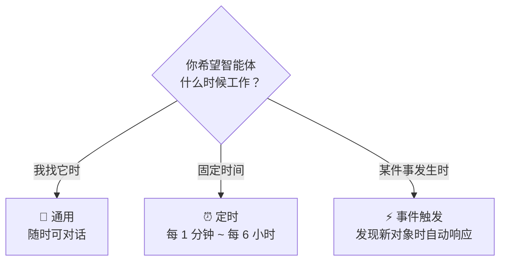
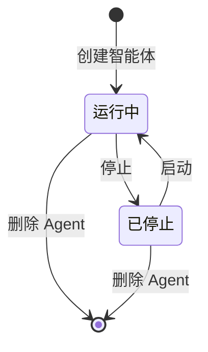

# 智能体概览

**智能体（Agent）** 是常驻在空间里的 AI 助手。和「应用」里一问一答的对话不同，智能体创建后会**一直待命**：你可以随时找它聊，也可以让它**按时间自动运行**，或者在**发现某类对象时自动响应**。

<Shot src="/media/zh/agent-config.png" caption="智能体模块：左侧列表 · 中间配置 · 右侧预览对话" marks="10,19,1|38,14,2|80,14,3" />

| 区域 | 内容 |
| --- | --- |
| ① 智能体列表 | 「新建智能体」按钮 + 当前空间的所有智能体。每项显示状态点、类型徽标（通用/定时/事件触发）和职责摘要 |
| ② 配置区 | 名称、模型、背景知识、职责等，可切换「配置 / YAML」视图 |
| ③ 工作台 | 「智能体预览」对话框，以及可固定的 MCPs、Skills、Skill 商店标签 |

## 三种类型，怎么选？

| 类型 | 适合场景 | 必填项 | 举例 |
| --- | --- | --- | --- |
| 💬 **通用** | 随时可对话，按设定的职责回答问题 | 智能体名称 | 「空间数据顾问」：回答客流、设备相关问题 |
| ⏰ **定时** | 按固定频率自动执行任务，无需手动触发 | 任务描述 | 每小时汇总一次客流并生成摘要 |
| ⚡ **事件触发** | 发现你关注的对象类型出现时自动处理 | 关注的对象 + 发现后要做什么 | 出现新的摄像头（camera）时自动整理信息并通知我 |

::: tip 类型创建后不能修改
运行方式在创建时决定。配置页会提示：「当前为通用智能体；定时 / 事件触发请在创建时选择对应类型。」想换类型，请新建一个。
:::

## 状态与生命周期

- 列表中的 **绿色圆点** 与配置区顶部的「通用 · 运行中」表示智能体正在运行。
- **定时** 智能体创建后**需要启动**才会按计划运行。

## 下一步

- [新建智能体](/agents/create)：三种类型的完整填写说明。
- [配置与试运行](/agents/manage)：修改配置、YAML、与智能体对话、MCP 与 Skills。
