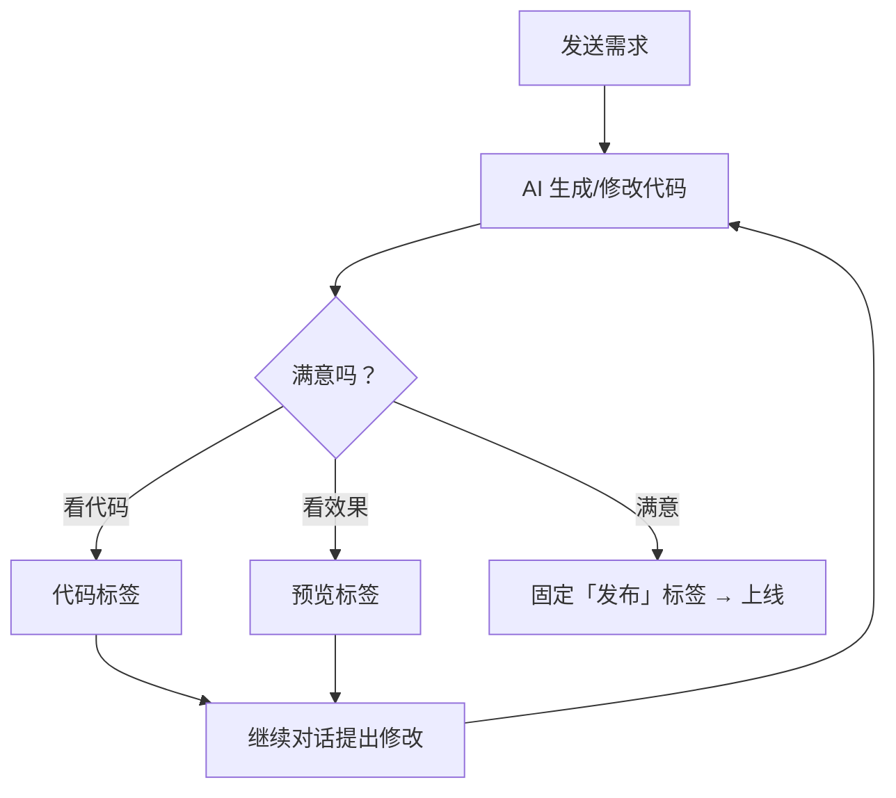

# 代码工作台

当你在「应用」里发起对话后，右侧会自动出现**代码工作台**。它把 AI 生成的项目直接摆在你面前：看文件、看效果、看空间。

<Shot src="/media/zh/app-conversation.png" caption="右侧即代码工作台：顶部为标签页，下方为文件树与编辑器" marks="83,2,1|94,2,2|97,2,3" />

## 三个默认标签页

| 标签 | 用途 | 你会看到 |
| --- | --- | --- |
| **代码** | 浏览、编辑项目文件 | 项目根目录名、文件树（可「过滤文件和文件夹...」、可「刷新文件树」）、编辑器；未选文件时提示「选择左侧文件以打开编辑」 |
| **预览** | 实时运行项目并预览页面 | 首次打开显示「安装依赖并启动中，请稍候...」，就绪后显示页面 |
| **空间** | 查看与当前空间相关的视图 | 顶部附带刷新、复制、全屏等操作按钮 |

<Shot src="/media/zh/app-preview-tab.png" caption="预览：首次启动会自动安装依赖" />

底部还有一条可展开的 **终端** 栏（「展开日志与终端」），用来查看运行日志和命令输出。

## 固定更多标签页

点击标签栏右侧的 **＋（固定标签页）**，可以把下面的面板固定到工作台：

<Shot src="/media/zh/app-pin-menu.png" caption="固定标签页菜单：智能体 / 服务 / 发布" />

| 选项 | 作用 |
| --- | --- |
| **智能体** | 在当前对话旁边查看和使用智能体，详见 [智能体](/agents/overview) |
| **服务** | 查看由对话生成的 API 服务，详见 [服务](/services/overview) |
| **发布** | 把当前项目发布上线 |

## 收起工作台

点击最右侧的 **折叠代码与预览**，工作台收起，对话区变宽；再次点击（「展开代码与预览」）恢复。也可以拖动对话区与工作台之间的分隔条来调整比例。

