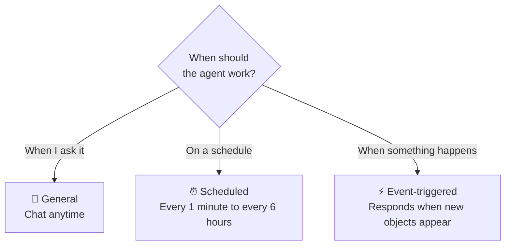
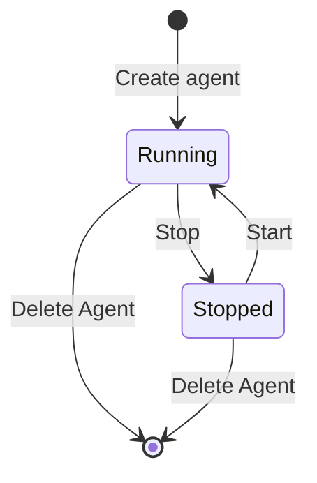

# Agents overview

An **agent** is an AI assistant that lives in your space. Unlike the back-and-forth conversations in **Apps** (应用), an agent **stays on standby** once created: chat with it anytime, have it **run automatically on a schedule**, or have it **respond automatically when certain objects appear**.

<Shot src="/media/zh/agent-config.png" caption="Agents module: list on the left · configuration in the middle · preview chat on the right" marks="10,19,1|38,14,2|80,14,3" />

| Area | Contents |
| --- | --- |
| ① Agent list | The **New agent** (新建智能体) button plus every agent in the current space. Each entry shows a status dot, a type badge (General/Scheduled/Event-triggered) and a summary of its responsibilities |
| ② Configuration | Name, model, background knowledge, responsibilities, and more; switch between **Config / YAML** (配置 / YAML) views |
| ③ Workbench | The **Agent preview** (智能体预览) chat, plus pinnable MCPs, Skills, and Skill store tabs |

## Which type should I choose?

| Type | Best for | Required | Example |
| --- | --- | --- | --- |
| 💬 **General** (通用) | Chat anytime; answers questions according to its responsibilities | Agent name | "Space data advisor": answers questions about foot traffic and devices |
| ⏰ **Scheduled** (定时) | Runs tasks at a fixed frequency, no manual trigger | Task description | Summarize foot traffic every hour and generate a digest |
| ⚡ **Event-triggered** (事件触发) | Acts automatically when an object type you watch appears | Objects to watch + what to do when found | When a new camera (camera) appears, summarize its info and notify me |

::: tip The type can't be changed after creation
The run mode is set at creation. The config page notes: "This is a general agent; choose the Scheduled or Event-triggered type at creation." (当前为通用智能体；定时 / 事件触发请在创建时选择对应类型。) To switch types, create a new agent.
:::

## Status and lifecycle

- A **green dot** in the list and "General · Running" (通用 · 运行中) at the top of the configuration mean the agent is running.
- **Scheduled** agents **must be started** after creation before they run on schedule.

## Next steps

- [Create an agent](/en/agents/create): complete field-by-field guide for all three types.
- [Configure and test-run](/en/agents/manage): edit the configuration, YAML, chat with the agent, MCP and Skills.
