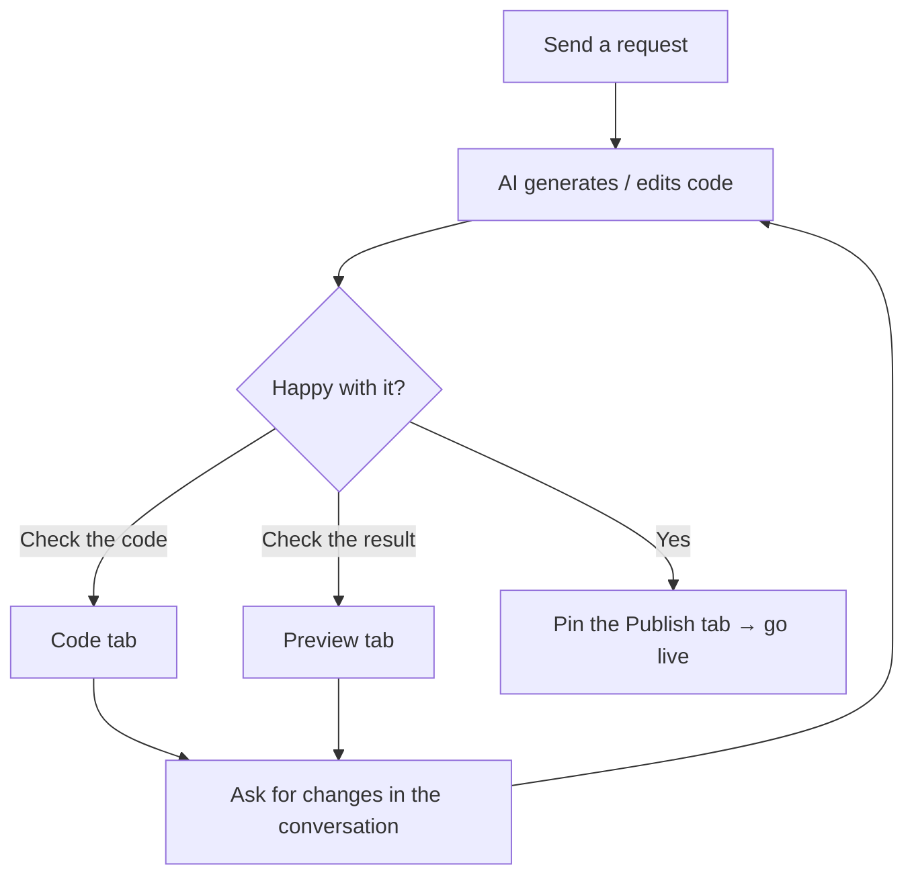

# Code workbench

Once you start a conversation in **Apps** (应用), the **code workbench** opens on the right. It puts the AI-generated project right in front of you: browse files, see results, and view the space.

<Shot src="/media/zh/app-conversation.png" caption="The code workbench on the right: tabs at the top, file tree and editor below" marks="83,2,1|94,2,2|97,2,3" />

## Three default tabs

| Tab | Purpose | What you'll see |
| --- | --- | --- |
| **Code** (代码) | Browse and edit project files | Project root name, file tree (with "Filter files and folders..." (过滤文件和文件夹...) and **Refresh file tree** (刷新文件树)), and the editor; with no file selected it shows "Select a file on the left to edit" (选择左侧文件以打开编辑) |
| **Preview** (预览) | Run the project live and preview pages | On first open it shows "Installing dependencies and starting, please wait..." (安装依赖并启动中，请稍候...), then the page once ready |
| **Space** (空间) | View content related to the current space | Action buttons at the top for refresh, copy, full screen, and more |

<Shot src="/media/zh/app-preview-tab.png" caption="Preview: dependencies install automatically on first launch" />

At the bottom there's also an expandable **Terminal** (终端) bar ("Expand logs and terminal" (展开日志与终端)) for viewing run logs and command output.

## Pin more tabs

Click **＋** (**Pin tab** (固定标签页)) at the right of the tab bar to pin these panels to the workbench:

<Shot src="/media/zh/app-pin-menu.png" caption="Pin tab menu: Agents / Services / Publish" />

| Option | What it does |
| --- | --- |
| **Agents** (智能体) | View and use agents alongside the current conversation. See [Agents](/en/agents/overview) |
| **Services** (服务) | View API services generated from conversations. See [Services](/en/services/overview) |
| **Publish** (发布) | Publish the current project |

## Collapse the workbench

Click **Collapse Code and preview** (折叠代码与预览) on the far right to hide the workbench and widen the conversation area; click it again (**Expand Code and preview** (展开代码与预览)) to restore it. You can also drag the divider between the conversation and the workbench to adjust the ratio.

