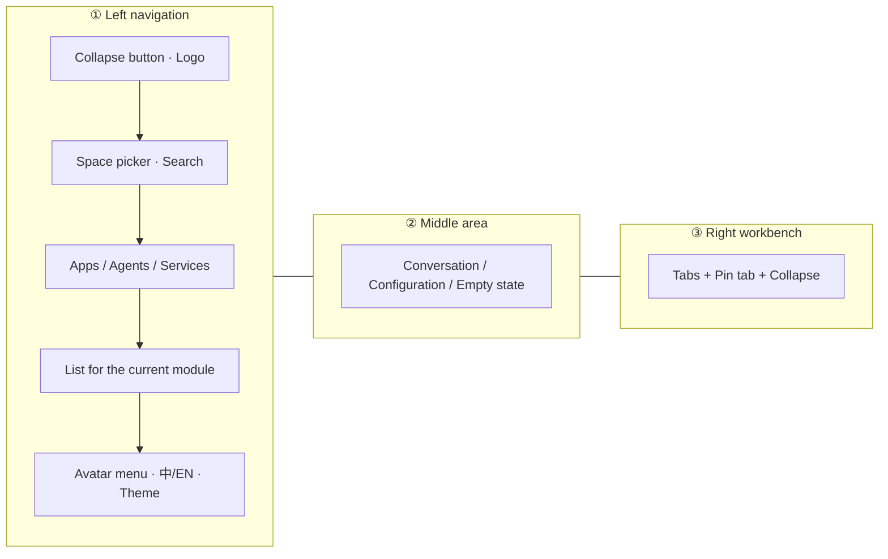

# Interface tour

Spatial Smart is a **three-pane workspace**: navigation on the left, the conversation or configuration area in the middle, and the workbench (code, preview, tabs) on the right. You can drag the dividers between panes to resize them.

<Shot src="/media/zh/service-overview.png" caption="Three-pane layout: ① Navigation ② Conversation area ③ Workbench" marks="10,40,1|38,40,2|80,40,3" />

## ① Left navigation

| Location | Control | What it does |
| --- | --- | --- |
| Top left | **Collapse Application navigation** (折叠应用导航) | Hides the whole navigation pane so the middle and right areas get wider; click **Expand Application navigation** (展开应用导航) to restore it |
| Top | **Logo (✦)** | Returns to the **Apps** (应用) module |
| Top | **Space picker** — "Select a space..." (请选择空间...) | Switches the current space. See [Spaces](/en/guide/space) |
| Top | **Search (🔍)** | Opens **Global search** (全局搜索) to search messages across all conversations |
| Middle | **Apps / Agents / Services** (应用 / 智能体 / 服务) | Switches between the three modules; a blue underline marks the current one |
| Middle | List | Conversations, agents, or services in the current module |
| Bottom | **Avatar** | Personal menu: Settings, Monthly usage, Feedback, Sign out |
| Bottom | **中 / EN** | Switches the interface language. See [Language and appearance](/en/settings/appearance) |
| Bottom | **Toggle theme** (切换主题) **(☀/☾)** | Switches between light and dark |

<Shot src="/media/zh/shell-collapsed.png" caption="After clicking Collapse Application navigation, the navigation pane hides and the workspace fills the screen" />

## Global search

Click the magnifier in the top-left corner to open the **Global search** (全局搜索) dialog. It searches **message content across all conversations**, with keyword highlighting and quick jump-to.

<Shot src="/media/zh/shell-search.png" caption="Global search: after you type a keyword, filters for time and message type appear" />

::: steps
1. Type a keyword in the input box (the **Search** (搜索) button stays gray until you do).
2. Optional: choose a time range — All time / Last 1 day / Last 7 days / Last 30 days.
3. Optional: choose a message type — All messages / User messages / Assistant messages.
4. Click **Search**. If nothing matches, you'll see `未找到包含 "关键字" 的结果` (No results containing "keyword").
5. Click × in the top-right corner or press <kbd>Esc</kbd> to close.
:::

## ② Middle area

The middle area changes with the module: in **Apps** it shows the conversation and input box; in **Agents** it shows the agent's configuration; in **Services** it shows the service's conversation history. When nothing is selected, a hint appears, such as **No service selected** (还没有选中服务).

## ③ Right workbench

The right workbench is a row of **tabs**, with two fixed buttons on the far right:

- **＋ Pin tab** (固定标签页): pins additional panels as tabs (options vary by module). Once everything is pinned, it shows "All tabs pinned" (全部标签页已固定).
- **Collapse Code and preview** (折叠代码与预览): hides the whole workbench so the middle area fills the space; click it again (now labeled **Expand Code and preview** (展开代码与预览)) to restore it.

## Resize panes

You can drag the two vertical dividers:

- Navigation ↔ middle area: when narrowed, long names are truncated with an ellipsis.
- Middle area ↔ workbench: adjusts the ratio between conversation and code.

::: tip
While the navigation pane is collapsed, the left divider can't be dragged. Expand the navigation first.
:::
