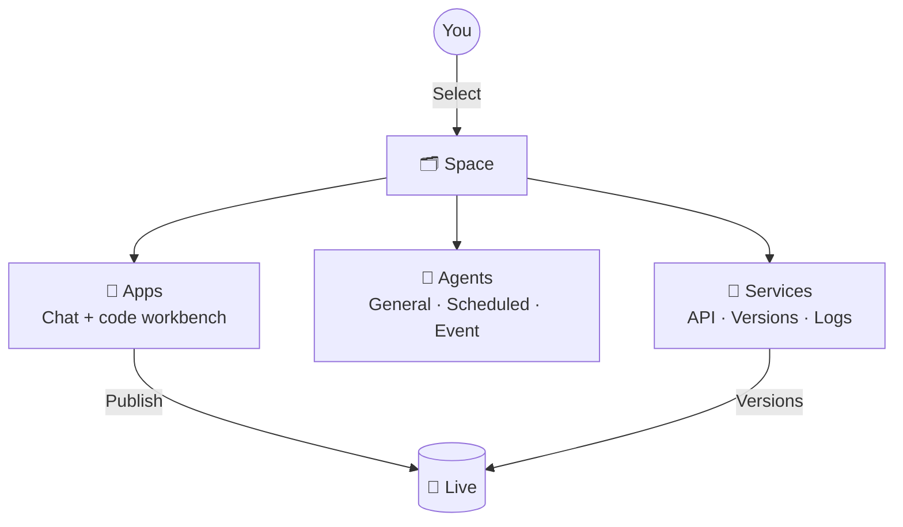

# Product overview

**Spatial Smart** (page title *Spatial Smart - Vibe coding for Space*) is Pinefield's spatial intelligence development platform. Just **describe what you need in plain language**, and the platform's AI writes code, builds agents, and publishes API services — then runs them inside your **space**.

<Kv :rows="[
  ['URL', '<a href=&quot;https://alpha.pinefield.cn/pinefield.spatial-smart/&quot; target=&quot;_blank&quot;>alpha.pinefield.cn/pinefield.spatial-smart</a>'],
  ['Sign-in', 'Single sign-on (SSO): account + password + 6-digit image captcha'],
  ['Interface language', 'Chinese / English, one click in the bottom-left corner'],
  ['Who it is for', 'Business and engineering teams who want to use AI to quickly build spatial apps, automations, or data APIs'],
]" />

## Three modules at a glance

The top-left corner has three module tabs: **Apps** (应用), **Agents** (智能体), and **Services** (服务). All of them work inside the **space** you select.

| Module | In one sentence | Use it to… | Details |
| --- | --- | --- | --- |
| 💬 Apps | Build projects by chatting with AI | Write code, preview, manage workspaces | [Start a conversation](/en/apps/chat) |
| 🤖 Agents | AI that lives in your space and works on its own | Generate daily reports, handle alerts automatically | [Agents overview](/en/agents/overview) |
| 🔌 Services | API endpoints generated from conversations | Feed data to dashboards and external systems | [Services overview](/en/services/overview) |

## Core concepts

::: tip Space
The top-level container. Each space has a name and a unique ID (UUID). **Almost every button requires a space to be selected first**; otherwise it's grayed out. → [Spaces](/en/guide/space)
:::

::: info Workspace
The project container in **Apps**. Each conversation generates code files inside a workspace. Choose a recent workspace or create a new one from the **Workspace** (工作空间) menu below the input box.
:::

::: info Conversation
One continuous exchange between you and the AI. Conversations are named after your first message automatically and can be renamed. In **Services**, each service also has its own conversations.
:::

## Recommended learning path

::: steps
1. **[Sign in](/en/guide/login)** — learn the captcha trick to avoid repeated failures.
2. **[Get to know the interface](/en/guide/interface)** — three-pane layout, sidebar, search, personal menu.
3. **[Select a space](/en/guide/space)** — the starting point for all work.
4. **Learn modules as needed** — [Apps](/en/apps/chat) · [Agents](/en/agents/overview) · [Services](/en/services/overview).
5. **Run into a problem?** — check the [FAQ](/en/reference/faq) first, then submit via **Feedback** (建议反馈) in the bottom-left corner.
:::
