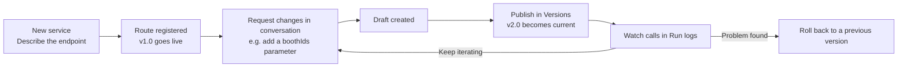

# Services overview

A **service** is an **API endpoint** generated from a conversation. Describe the endpoint in one sentence and the platform registers the route automatically; external systems (dashboards, business systems, scripts) call it at its URL. Every service has versioning and run logs, and if something breaks you can roll back in one click.

<Shot src="/media/zh/service-overview.png" caption="Services module: ① Service tree ② Service conversation ③ Service workbench" marks="10,30,1|38,25,2|80,25,3" />

## The full lifecycle of a service

## Service tree (left)

<Shot src="/media/zh/service-row-menu.png" caption="Service tree and the Project menu" />

- Each **service** is a folder. A **green dot** after its name means the endpoint is **Available** (可用) — published and online.
- Under each service are its **conversations** (e.g. "Conversation: Create foot-traffic query endpoint", "Conversation: Add booth filter parameter"), recording how the service evolved step by step. Click one to review it.
- Hover over a service row to reveal two small buttons:

| Button | What it does |
| --- | --- |
| **＋** | Starts a new conversation under that service |
| **⋯ Project menu** (项目菜单) | New conversation · Stop service · Delete service (red, destructive) |

## Middle: service conversation

Opening a service automatically opens its first conversation.

- The status line at the top shows endpoint info, e.g. `POST /api/v1/booth-flow · 接口可用` (endpoint available).
- AI replies appear as cards, such as "API service created · POST /api/v1/booth-flow" (API 服务已创建 · POST /api/v1/booth-flow), with a `SERVICE · v1.0` version tag.
- Below each reply you can **Copy** (复制), **Rate** (评价), or **Continue in a new conversation** (在新会话中继续).
- The input box at the bottom reads: "Describe the change you want to make to this service, e.g. change the run frequency, add or remove parameters, or adjust the processing logic" (描述你要对该服务做的调整，例如修改执行频率、增删参数或调整处理逻辑).

<Shot src="/media/zh/service-conversation-2.png" caption="Second conversation: add a boothIds parameter → v2.0 published" />

## Next steps

- [Create an API service](/en/services/create)
- [Service workbench](/en/services/workbench): Overview, Code, Versions, Run logs
