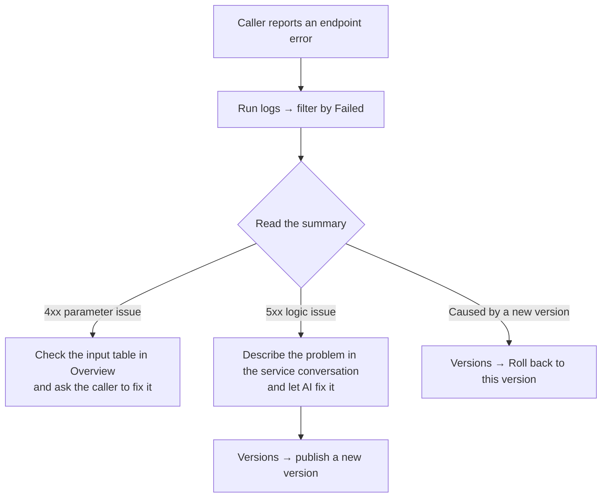

# Service workbench

Once you select a service, the **service workbench** on the right has four tabs.

<Demo src="/media/zh/flow-service-workbench.mp4" caption="A tour of Overview, Code, Versions, and Run logs" />

## Overview

The service's "manual" — and the API reference for callers. Tab: **Overview** (总览).

<Shot src="/media/zh/service-overview.png" caption="Overview: status, endpoint URL, input, output, and example call" />

| Section | Contents |
| --- | --- |
| Title and badge | Service name + a green **Available** (可用) badge, followed by the description and tags (Service / API / version / creation date) |
| Endpoint status | Current status, method, calls in the last 24 hours, average latency / failure rate; **Mark as unavailable** (标记为不可用) takes the endpoint offline temporarily |
| Endpoint URL | Full URL with a one-click copy button |
| Input parameters | Name, type, required, and description, e.g. `startTime` `string` required "Query start time (ISO 8601)" |
| Output parameters | Returned fields and types, e.g. `series` `object[]` |
| Example call | A ready-to-copy `curl` command |

## Code

<Shot src="/media/zh/service-code.png" caption="Code: edit the service's handler online" />

- The **Code** (代码) tab description reads: "Service handler code (illustrative). Edit and save directly; changes become a draft in Versions." (服务处理代码（示意）。可直接编辑并保存，修改将进入「版本管理」的待发布草稿。)
- The file is `src/service.ts`, which uses `defineService` (from `@spatialsmart/faas`) to define `Input` / `Output`.
- **Revert** (还原) discards unsaved changes; **Save changes** (保存修改) saves them and creates a draft.

::: warning Saving ≠ going live
Saving code only creates a **draft**. It takes effect only after you publish it in **Versions**.
:::

## Versions

<Shot src="/media/zh/service-versions.png" caption="Versions: current version, history, rollback" />

The **Versions** (版本管理) tab description reads: "After adjusting the service through conversation, publish a new version here to go live; you can roll back to any previous version at any time." (通过对话调整服务后，需在此发布新版本上线；历史版本可随时回滚。)

| Status | Example | Available actions |
| --- | --- | --- |
| Draft (待发布草稿) | Appears after changes from a conversation or the code editor | **Publish** (发布) (with no draft, it shows "No unpublished changes…" (当前没有待发布的修改…)) |
| Current version (当前版本) | `v2.0 · 当前版本` · Added boothIds filter parameter | **Take offline** (下线) |
| Previous version (历史版本) | `v1.0 · 历史版本` · Initial version | **Roll back to this version** (回滚到此版本) |

## Run logs

<Shot src="/media/zh/service-logs.png" caption="Run logs: time, source, status, duration, and summary for every call" />

- Columns in **Run logs** (运行日志): **Time · Source · Status · Duration · Summary** (时间 · 来源 · 状态 · 耗时 · 摘要). The summary shows the HTTP status code and reason, e.g. `400 · 缺少必填参数 endTime` (missing required parameter endTime).
- Filter at the top: **All / Success / Failed** (全部 / 成功 / 失败) — pick one. When troubleshooting, start with **Failed**.

<Shot src="/media/zh/service-logs-failed.png" caption="Showing failed calls only" />

## Pin tab and collapse

- **＋ Pin tab** (固定标签页): when all four tabs are pinned, it shows "All tabs pinned" (全部标签页已固定).
- **Collapse Code and preview** (折叠代码与预览): hides the workbench so the service conversation fills the space; there's also a button with the same function at the top of the middle area.

## Common troubleshooting flow

