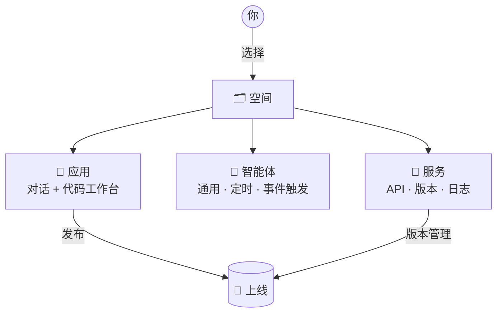

# 产品概览

**Spatial Smart**（页面标题 *Spatial Smart - Vibe coding for Space*）是松田（Pinefield）推出的空间智能开发平台。你只需要**用自然语言描述需求**，平台里的 AI 就会帮你写代码、搭建智能体、发布 API 服务，并把它们放进你所在的「空间」里运行。

<Kv :rows="[
  ['访问地址', 'alpha.pinefield.cn/pinefield.spatial-smart'],
  ['登录方式', '松田统一登录（SSO）：账号 + 密码 + 6 位图片验证码'],
  ['界面语言', '中文 / English，左下角一键切换'],
  ['适合谁', '想用 AI 快速做空间类应用、自动化任务或数据接口的业务与开发人员'],
]" />

## 三大模块，一张图看懂

平台左上角有三个模块标签：**应用**、**智能体**、**服务**。它们都在你选中的**空间**里工作。

| 模块 | 一句话说明 | 你会用它来… | 详细文档 |
| --- | --- | --- | --- |
| 💬 应用 | 和 AI 对话来开发项目 | 写代码、看预览、管理工作空间 | [发起对话](/apps/chat) |
| 🤖 智能体 | 常驻空间、可以自动干活的 AI | 每天定时出报告、发现告警自动处理 | [智能体概览](/agents/overview) |
| 🔌 服务 | 由对话生成的 API 接口 | 给大屏、外部系统提供数据 | [服务概览](/services/overview) |

## 几个核心概念

::: tip 空间（Space）
最顶层的容器。每个空间有名称和唯一 ID（UUID）。**几乎所有按钮都要求先选空间**，否则会显示为灰色。→ [空间与切换](/guide/space)
:::

::: info 工作空间（Workspace）
「应用」模块里的项目容器。一次对话会在某个工作空间里生成代码文件。可在输入框下方的「工作空间」菜单里选择最近的工作空间或新建。
:::

::: info 会话（Conversation）
你和 AI 的一次连续对话。会话会自动以第一句话命名，可以重命名。服务模块中，每个服务下面也挂着若干「对话」。
:::

## 推荐学习路径

::: steps
1. **[登录](/guide/login)** —— 了解验证码的小技巧，避免反复失败。
2. **[认识界面](/guide/interface)** —— 三栏布局、侧边栏、搜索、个人菜单。
3. **[选择空间](/guide/space)** —— 一切工作的起点。
4. **按需学习模块** —— [应用](/apps/chat) · [智能体](/agents/overview) · [服务](/services/overview)。
5. **遇到问题** —— 先查 [常见问题](/reference/faq)，再用左下角「建议反馈」提交。
:::
