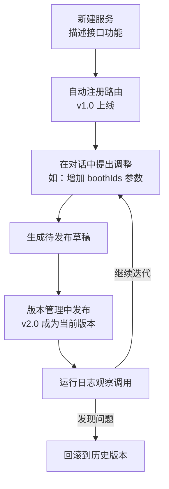

# 服务概览

**服务**是由对话生成的 **API 接口**。你用一句话描述接口功能，平台自动注册路由；外部系统（大屏、业务系统、脚本）通过调用地址即可访问。每个服务都有版本管理、运行日志，改坏了可以一键回滚。

<Shot src="/media/zh/service-overview.png" caption="服务模块：① 服务树 ② 服务对话 ③ 服务工作区" marks="10,30,1|38,25,2|80,25,3" />

## 一个服务的完整生命周期

## 左侧服务树

<Shot src="/media/zh/service-row-menu.png" caption="服务树与「项目菜单」" />

- 每个**服务**是一个文件夹，名字后面的 **绿色圆点** 表示接口「可用」（已发布且在线）。
- 服务下面挂着若干 **对话**（如「对话：创建客流查询接口」「对话：增加展位筛选参数」），记录了这个服务是怎么一步步改出来的。点击对话可查看当时的过程。
- 鼠标悬停在服务行上，会出现两个小按钮：

| 按钮 | 作用 |
| --- | --- |
| **＋** | 在该服务下新建一个对话 |
| **⋯ 项目菜单** | 新建对话 · 停止服务 · 删除服务（红色，危险操作） |

## 中间：服务对话

打开一个服务时，会自动打开它的第一个对话。

- 顶部状态行显示接口信息，例如 `POST /api/v1/booth-flow · 接口可用`。
- AI 的回复以卡片呈现，例如「API 服务已创建 · POST /api/v1/booth-flow」，并带有 `SERVICE · v1.0` 版本标签。
- 每条回复下方可以 **复制**、**评价（Rate）** 或 **在新会话中继续**。
- 底部输入框：「描述你要对该服务做的调整，例如修改执行频率、增删参数或调整处理逻辑」。

<Shot src="/media/zh/service-conversation-2.png" caption="第二个对话：加一个 boothIds 参数 → 已发布 v2.0" />

## 下一步

- [新建 API 服务](/services/create)
- [服务工作区](/services/workbench)：总览、代码、版本管理、运行日志
