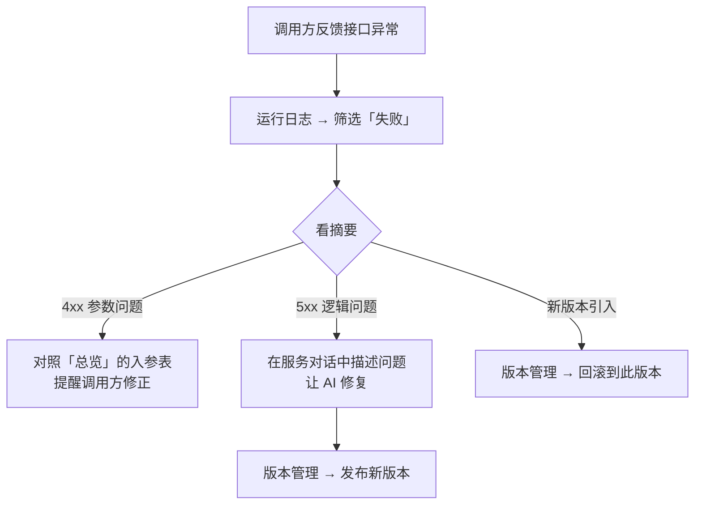

# 服务工作区

选中一个服务后，右侧 **服务工作区** 有四个标签页。

<Demo src="/media/zh/flow-service-workbench.mp4" caption="依次查看总览、代码、版本管理、运行日志" />

## 总览

服务的「说明书」，也是给调用方看的接口文档。

<Shot src="/media/zh/service-overview.png" caption="总览：状态、调用地址、入参、出参、调用示例" />

| 区块 | 内容 |
| --- | --- |
| 标题与徽标 | 服务名 + 绿色「可用」徽标，下方是描述和标签（服务 / API / 版本 / 创建日期） |
| 接口状态 | 当前状态、请求方式、近 24 小时调用次数、平均延迟 / 失败率；**「标记为不可用」** 可临时下线接口 |
| 调用地址 | 完整 URL，右侧一键复制 |
| 入参参数 | 参数名、类型、是否必填、说明，例如 `startTime` `string` 必填「查询起始时间（ISO 8601）」 |
| 出参参数 | 返回字段与类型，例如 `series` `object[]` |
| 调用示例 | 可直接复制的 `curl` 命令 |

## 代码

<Shot src="/media/zh/service-code.png" caption="代码：在线编辑服务处理逻辑" />

- 说明：「服务处理代码（示意）。可直接编辑并保存，修改将进入「版本管理」的待发布草稿。」
- 文件为 `src/service.ts`，使用 `defineService`（来自 `@spatialsmart/faas`）定义 `Input` / `Output`。
- **还原**：放弃未保存的修改；**保存修改**：保存并生成待发布草稿。

::: warning 保存 ≠ 上线
保存代码只会生成**草稿**，需要到「版本管理」里发布后才会生效。
:::

## 版本管理

<Shot src="/media/zh/service-versions.png" caption="版本管理：当前版本、历史版本、回滚" />

说明：「通过对话调整服务后，需在此发布新版本上线；历史版本可随时回滚。」

| 状态 | 示例 | 可用操作 |
| --- | --- | --- |
| 待发布草稿 | 对话或代码修改后出现 | **发布**（没有草稿时提示「当前没有待发布的修改…」） |
| 当前版本 | `v2.0 · 当前版本` · 新增 boothIds 筛选参数 | **下线** |
| 历史版本 | `v1.0 · 历史版本` · 初始版本 | **回滚到此版本** |

## 运行日志

<Shot src="/media/zh/service-logs.png" caption="运行日志：每一次调用的时间、来源、状态、耗时、摘要" />

- 列：**时间 · 来源 · 状态 · 耗时 · 摘要**。摘要里能看到 HTTP 状态码和原因，例如 `400 · 缺少必填参数 endTime`。
- 顶部筛选：**全部 / 成功 / 失败**（三选一）。排查问题时先点「失败」。

<Shot src="/media/zh/service-logs-failed.png" caption="只看失败的调用" />

## 固定标签页与折叠

- **＋ 固定标签页**：四个标签已全部固定时显示「全部标签页已固定」。
- **折叠代码与预览**：收起工作区，让服务对话占满；中间区域顶部也有一个相同功能的按钮。

## 常见排查流程

